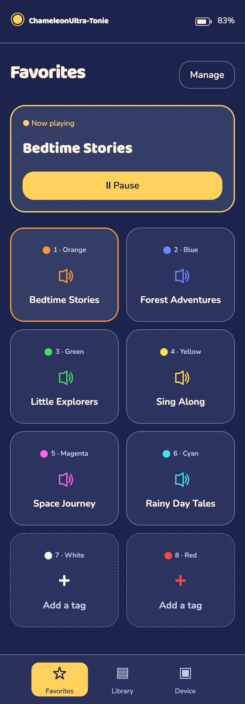
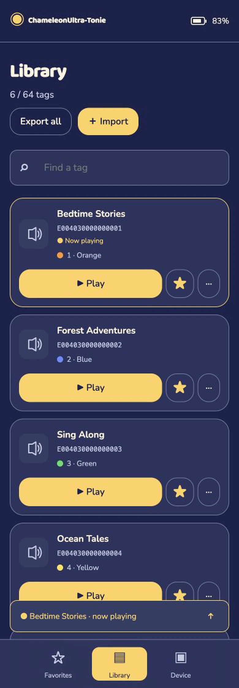
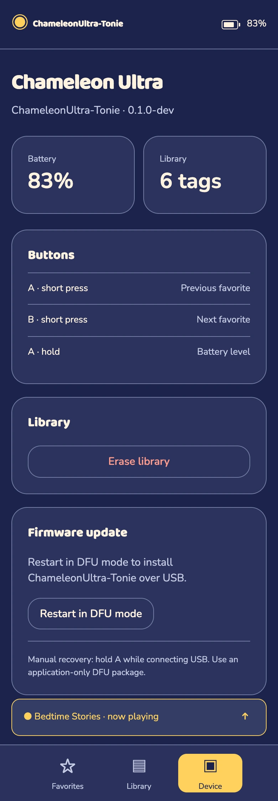

<h1 align="center">ChameleonUltra-Tonie</h1>

<strong>Your Tonies, in your pocket.</strong>

Firmware for the ChameleonUltra, with SLIX-L tag emulation,
a web interface to manage your tags, and favorites you can select with
the buttons.

[Install](#install-from-the-official-chameleon-ultra-firmware) ·
[Get started](#get-started) · [Your collection](#your-collection) ·
[Updates](docs/updates.md) · [Development](docs/development.md) ·
[Documentation](#documentation) · [Demo](#see-it-in-action)

> **Experimental** Tested on Toniebox 1 with a ChameleonUltra clone.

## Features

- Import Flipper SLIX/SLIX-L `.nfc` files and manage up to 64 tags through the web interface.
- Assign favorites and switch between them with the A/B buttons.
- Open the offline web interface over USB Ethernet, with no companion app.

## See it in action

https://github.com/user-attachments/assets/14ebd63d-b2e0-49a1-87a2-8f7c22ec95e9

|                                                                                     Favorites                                                                                      |                                                                                Library                                                                                |                                                                                     Device                                                                                      |
| :--------------------------------------------------------------------------------------------------------------------------------------------------------------------------------: | :-------------------------------------------------------------------------------------------------------------------------------------------------------------------: | :-----------------------------------------------------------------------------------------------------------------------------------------------------------------------------: |
|  |  |  |

## Install from the official Chameleon Ultra firmware

Use the [browser DFU flasher](https://taichunmin.idv.tw/chameleon-ultra.js/dfu.html)
in desktop Chrome with a USB data cable. No local tools or firmware build are needed.

Releases contain only the application and use the Ultra's existing Nordic DFU
bootloader.

1. Download the DFU ZIP for your chosen release from this project's **GitHub Releases**
   (for example, `ChameleonUltra-Tonie-v1.0.0-dfu.zip` for version `v1.0.0`).
2. Open the flasher and choose **USB Serial (PC only)** as the connection method.
3. Under **From Zip File**, select the downloaded ZIP.
4. Enter DFU: disconnect the Ultra, let it sleep, then hold **B** while
   reconnecting USB. Release B after connection. See the
   [official instructions](https://github.com/RfidResearchGroup/ChameleonUltra/wiki/firmware#the-bootloader)
   for Windows timing and other entry methods.
5. Click **Update selected**, choose the Ultra's DFU USB port, and wait for restart.
   Then open **[192.168.7.1](http://192.168.7.1)**.

Use **From Zip File**; the GitHub selector lists upstream firmware. Keep a backup
and a working application package, preserve the bootloader, and independently
verify recovery before remote updates. Browser DFU still needs hardware validation
with this integration.

For other bootloaders, later updates, or the `nrfutil` fallback, see
[Updates and recovery](docs/updates.md).

## Get started

With ChameleonUltra-Tonie installed, connect the Ultra to your iPhone, PC, or
another device using a USB data cable and an adapter if needed. The device must
support USB Ethernet. The firmware offers RNDIS for Windows 10/11 and CDC-ECM
for Linux and other ECM hosts. RNDIS web access has been tested on Linux and
Windows 11; Windows 10 and iPhone still need hardware validation. Open **[192.168.7.1](http://192.168.7.1)** in its browser. Import your `.nfc` files, assign a
favorite, then press **Play** to enable tag emulation. “Now playing” refers to
emulation; the Ultra does not store or play audio.

The web interface works offline and requires no companion app. If the page
does not open, check the USB data cable and Ethernet connection. iPhone adapters,
power, and Safari still need hardware validation.

## Your collection

- Import `.nfc` files, assign favorites, and use **Play/Pause**.
- Switch favorites with A/B; hold A to check the battery.
- Use **Export all** to back up your tags; favorites are not included.

Reader writes are never saved automatically. Reloading restores the original.
Hardware controls and power behavior still need validation.

## NFC-V implementation

The nRF52840 has no native NFC-V tag controller. This firmware decodes commands
in software and sends replies through the Ultra's physical `HF_ANT_SEL` antenna
switch on the unmodified board.

The project focuses on SLIX-L emulation on the Ultra. It has no BLE,
physical tag reading, additional tag families, RTOS, or frontend framework.
Reader compatibility is experimental; an accepted response from one reader
cannot establish compatibility with another.

[How NFC-V works on the Ultra →](docs/nfcv.md)

## Documentation

| Guide                                   | Covers                                                                    |
| --------------------------------------- | ------------------------------------------------------------------------- |
| [Development](docs/development.md)      | Build and test, local simulator, architecture, HTTP API, and releases     |
| [Updates and recovery](docs/updates.md) | Browser updates, CLI fallback, and storage preservation                   |
| [NFC-V implementation](docs/nfcv.md)    | Software reception, antenna-switch transmission, and compatibility limits |

## License

GPL-3.0; see [LICENSE](LICENSE). The SDK comes from the official
[RfidResearchGroup/ChameleonUltra repository](https://github.com/RfidResearchGroup/ChameleonUltra).
[Build inputs and licenses](docs/development.md#build-inputs-and-licenses).

For personal use with your own Tonie collection. Not intended for unauthorized
content sharing. Not affiliated with or endorsed by tonies.
